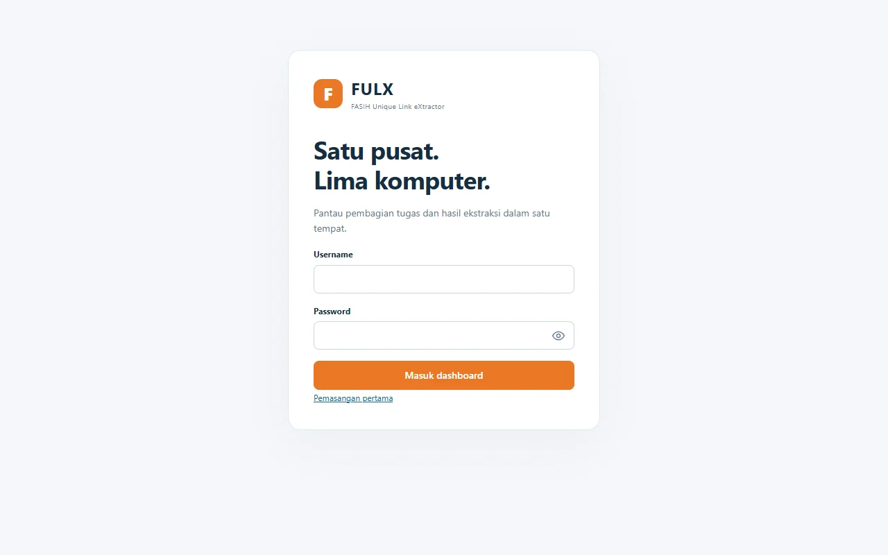
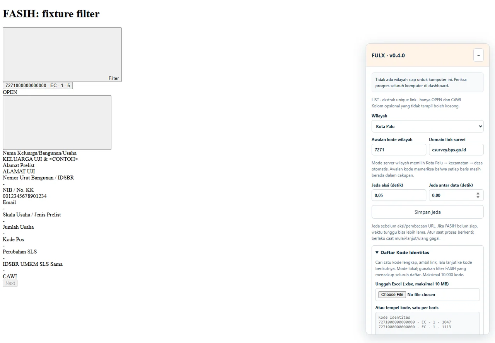

# FULX — FASIH Unique Link eXtractor

**v0.4.0** · Ekstensi Chrome Manifest V3 + server koordinator PHP 8.3/MySQL untuk mengekstrak link unik CAWI dari FASIH di **hingga 5 komputer secara paralel**.

🔗 **Dashboard Live:** [`https://fulx.pinnhost.my.id/`](https://fulx.pinnhost.my.id/) · [Panduan Instalasi](INSTALL.md) · [Deploy cPanel Git](DEPLOY_CPANEL_GIT.md)

<table>
  <tr>
    <td width="50%"></td>
    <td width="50%"></td>
  </tr>
</table>

### Alur Mengatasi Limit 1.000 Baris FASIH

```text
Filter Provinsi/Kota ─► Kec ──► Desa (≥1.000 baris? ─► Pecah SLS ─► SUBSLS) ─► Atomic Lock Server ─► Ekspor XLSX Gabungan
```

### Mode Operasi

| Mode | Skenario Penggunaan | Fitur Kunci |
| :--- | :--- | :--- |
| **Server 5-PC** | Pekerjaan tim skala kabupaten/kota (`fulx.pinnhost.my.id/api.php`) | Pembagian desa otomatis via atomic lock, pantauan 3 detik, gabung XLSX |
| **Daftar Kode Identitas** | Ekstraksi target spesifik via `.xlsx` atau tempel baris (`v0.4.0`) | Hingga 10.000 kode, jeda/lanjutkan progres, ekspor urutan asli |
| **Lokal Browser** | Tugas ad-hoc per 1 komputer tanpa koneksi server | Pilot 5 data, coba ulang gagal, backup JSON lokal |

### Pengembangan & Packaging

```bash
npm install
node scripts/check.cjs
node --test tests/*.test.cjs
node scripts/package.cjs
```
